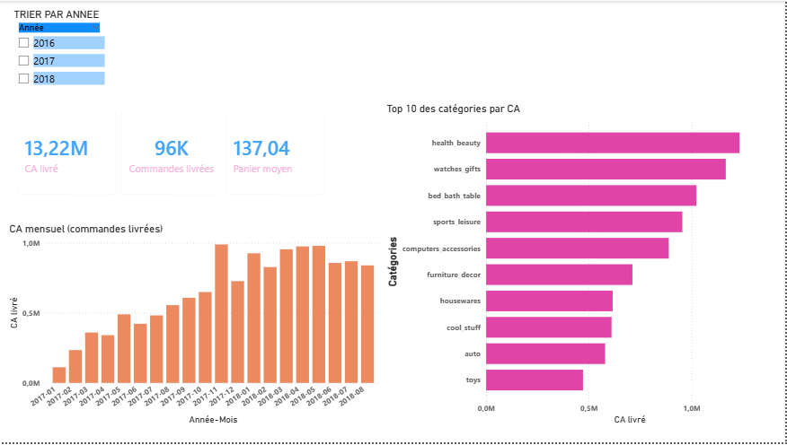
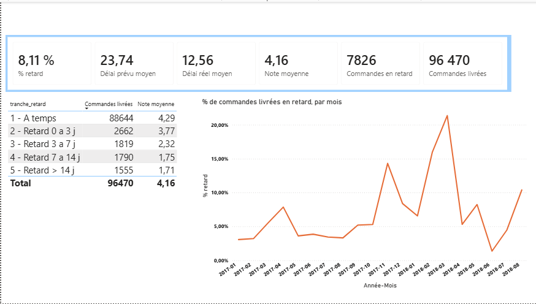
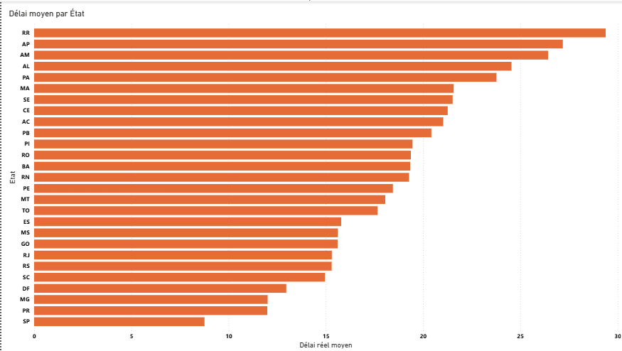

# Olist : analyse des ventes, des livraisons et de la satisfaction client (SQL Server + Power BI)

Projet d'analyse de données sur le jeu public **Olist** (e-commerce brésilien, 2016-2018) : environ 100 000 commandes réparties entre 8 tables relationnelles.
Les analyses sont faites en SQL, puis présentées dans un tableau de bord Power BI de trois pages.

## Questions traitées

1. Comment évolue le chiffre d'affaires (CA) dans le temps ?
2. Quelles catégories de produits génèrent le plus de CA ?
3. Les livraisons sont-elles rapides, et la date promise est-elle respectée ?
4. Un retard de livraison dégrade-t-il la satisfaction client ?
5. D'où viennent les clients et le CA ?
6. Les ventes dépendent-elles de quelques vendeurs ou de quelques États ?

## Outils

- **SQL Server Express et SSMS** : import, nettoyage, analyses (T-SQL : jointures, CTE, fonctions de fenêtre, `CASE`, `COALESCE`)
- **Power BI Desktop** : modèle de données, mesures DAX, tableau de bord

## Données

Source : *Brazilian E-Commerce Public Dataset by Olist*, publié par Olist sur Kaggle (https://www.kaggle.com/datasets/olistbr/brazilian-ecommerce). Les 8 fichiers CSV utilisés sont dans le dossier `data/`, tels que téléchargés (non modifiés). Les données appartiennent à Olist : voir la licence indiquée sur la page Kaggle.

| Table | Lignes |
|---|---|
| customers | 99 441 |
| orders | 99 441 |
| order_items | 112 650 |
| order_payments | 103 886 |
| order_reviews | 99 224 |
| products | 32 951 |
| sellers | 3 095 |
| product_category_name_translation | 71 |

## Méthode et définitions

- **Périmètre de base** : commandes livrées (`order_status = 'delivered'`). Les commandes annulées ou indisponibles sont exclues. Selon l'analyse, ce périmètre se réduit un peu (voir le tableau ci-dessous).
- **Chiffre d'affaires (CA)** : somme des prix des articles (`price`), hors frais de port. Sur le périmètre retenu : **13 221 498 R$**. Ce n'est pas un bénéfice : le jeu ne contient pas les coûts.
- **Panier moyen** : CA divisé par le nombre de commandes.
- **Retard** : commande livrée après `order_estimated_delivery_date`.
- **Délais** : calculés en jours avec décimales (`DATEDIFF` en secondes divisé par 86 400). 8 commandes livrées n'ont pas de date de livraison : elles sont exclues des analyses de délais.
- **Note client** : moyenne des notes par commande, car 547 commandes ont plusieurs avis.
- **Clients** : comptés avec `customer_unique_id`, car `customer_id` change à chaque commande.
- Les résultats SQL ont été recoupés avec un recalcul indépendant sur les fichiers CSV, puis avec les mesures du tableau de bord Power BI.

Trois périmètres sont utilisés selon la question :

| Périmètre | Commandes | Utilisé pour |
|---|---|---|
| Commandes livrées | 96 478 | CA, panier moyen, catégories, répartition géographique, vendeurs |
| Livrées avec une date de livraison | 96 470 | Délais et retards |
| Livrées, avec date de livraison et au moins un avis | 95 824 | Notes clients |


## Qualité des données : problèmes rencontrés et corrections

L'import automatique a produit plusieurs défauts, corrigés dans la première partie du script SQL (rejouable) :

| Problème | Correction |
|---|---|
| `product_weight_g` importé en `smallint` (max 32 767) alors que le fichier va jusqu'à 40 425 g | Passage en `INT` |
| `price` et `freight_value` importés en texte (`varchar`) | Conversion en `DECIMAL(10,2)`, contrôle : 13 591 643,70 de CA articles et 2 251 909,54 de frais de port sur 112 650 lignes |
| Ligne d'en-tête du CSV importée comme donnée (72 lignes au lieu de 71) | Suppression de la ligne |
| Colonnes de la table de traduction nommées `column1` et `column2` | Renommage |

Contrôle systématique après import : nombre de lignes de chaque table comparé aux fichiers sources.

## Résultats

### 1. Évolution mensuelle du CA

- Le CA passe de **112 k R$ en janvier 2017 à 925 k R$ en janvier 2018** (environ ×8). Cette croissance vient du nombre de commandes (×9,4) : le panier moyen reste stable, entre 124 et 152 R$ sur toute la période.
- **Novembre 2017** est un pic : 7 289 commandes (+63 % par rapport à octobre) et 988 k R$ de CA, probablement lié au Black Friday. Le panier moyen recule à 135 R$ : c'est un effet de volume.
- Depuis début 2018, l'activité se stabilise entre 6 000 et 7 100 commandes par mois.

### 2. Catégories de produits

- Les trois premières catégories (`health_beauty`, `watches_gifts`, `bed_bath_table`) représentent **25,8 % du CA**, les dix premières **62,4 %**. La première catégorie ne pèse que 9,3 % : pas de dépendance à une seule.
- Volume et valeur divergent : `bed_bath_table` a le plus de commandes (9 272) mais seulement 110 R$ par commande, alors que `watches_gifts` rapporte **212 R$ par commande** avec 5 495 commandes.

### 3. Délais de livraison

- Délai réel moyen : **12,6 jours**, pour un délai annoncé de 23,7 jours. Seules **8,11 %** des commandes (7 826) sont en retard : les dates estimées sont très larges (marge moyenne d'environ 11 jours).
- **Un délai long n'est pas un retard.** Roraima (RR), Amapá (AP), Amazonas (AM) et Rondônia (RO) ont les délais les plus longs (19 à 29 jours) mais peu de retards (3 à 12 %), car leurs dates estimées sont plus larges (39 à 46 jours, contre 19 jours pour São Paulo).
- Les États les plus touchés par les retards sont Alagoas (23,9 %), Maranhão (19,7 %), Ceará et Sergipe (environ 15 %), Bahia (14,0 %) et Rio de Janeiro (13,5 %). São Paulo, où la livraison est la plus rapide (8,8 jours), est à 5,9 %.
- Le taux de retard mensuel est de 3 à 5 % la plupart des mois de 2017, puis monte à **14,3 % en novembre 2017, 16,0 % en février 2018 et 21,4 % en mars 2018**. Les données ne permettent pas d'en identifier la cause.

### 4. Satisfaction et retards

| Tranche | Commandes notées | Note moyenne |
|---|---|---|
| À temps | 88 163 | 4,29 |
| Retard de 0 à 3 jours | 2 636 | 3,77 |
| Retard de 3 à 7 jours | 1 773 | 2,32 |
| Retard de 7 à 14 jours | 1 748 | 1,75 |
| Retard de plus de 14 jours | 1 504 | 1,71 |

En regroupant, les commandes à temps ont une note moyenne de **4,29** contre **2,57** pour les commandes en retard (7 661). La note chute surtout durant la première semaine de retard, puis stagne autour de 1,7. C'est une **association** observée dans les données, pas une preuve de causalité. Seules les commandes ayant reçu un avis sont comptées (95 824 commandes).

### 5. Répartition géographique des clients

- **São Paulo** concentre 38,3 % du CA client (5,07 M R$, 39 156 clients uniques). **SP + RJ + MG** représentent **63,4 %** du CA.
- Les États du Nord comptent peu de clients : par exemple 40 clients à Roraima et 66 à Amapá. Les pourcentages calculés sur ces États sont fragiles.

### 6. Vendeurs

- **2 970 vendeurs actifs** (sur 3 095) dans 22 États. Aucun vendeur à Alagoas, Tocantins, Acre, Amapá ni Roraima.
- L'offre est encore plus concentrée que la demande : **São Paulo regroupe 1 769 vendeurs et 64,4 % du CA vendeur**.
- Le top 10 des vendeurs pèse **13,3 % du CA** (1,75 M R$), dont 9 situés à São Paulo : le marché n'est pas dominé par quelques vendeurs.
- Certains États dépendent d'un seul vendeur. À Bahia, un vendeur sur 18 réalise 78 % du CA de l'État. Maranhão, Piauí, Pará et Amazonas n'ont qu'un vendeur.
- Deux profils dans le top 10 : un vendeur à fort panier (626 R$ par commande, Bahia) et un vendeur à fort volume (1 772 commandes à 111 R$, São Paulo).

## Tableau de bord Power BI

Le tableau de bord est construit sur les mêmes tables que l'analyse SQL, avec les mêmes définitions (périmètre, CA, retard, note). Chaque valeur affichée a été contrôlée contre le résultat SQL correspondant.

### Modèle de données

Huit relations : `order_items`, `order_payments` et `order_reviews` vers `orders` ; `order_items` vers `products` et `sellers` ; `orders` vers `customers` ; `products` vers la table de traduction ; et une table `Calendrier` reliée à la date d'achat des commandes. Le filtre se propage depuis `orders` vers les tables de faits, ce qui permet de reproduire le périmètre « commandes livrées » du SQL.

### Mesures principales (DAX)

```
CA livré = CALCULATE(SUM(order_items[price]), orders[order_status] = "delivered")
Commandes livrées = CALCULATE(DISTINCTCOUNT(orders[order_id]), orders[order_status] = "delivered")
Panier moyen = DIVIDE([CA livré], [Commandes livrées])
Délai réel moyen = AVERAGE(orders[delai_reel_j])
Délai prévu moyen = AVERAGE(orders[delai_prevu_j])
% retard = DIVIDE([Commandes en retard], COUNT(orders[en_retard]))
Note moyenne =
CALCULATE(
    AVERAGEX(VALUES(orders[order_id]), CALCULATE(AVERAGE(order_reviews[review_score]))),
    KEEPFILTERS(orders[en_retard] IN {0, 1})
)
```

La mesure `Note moyenne` calcule d'abord la note de chaque commande puis la moyenne de ces notes, comme dans le SQL. `KEEPFILTERS` conserve les filtres du visuel (par exemple le découpage à temps / en retard).

### Pages

**Page 1 : Chiffre d'affaires.** Segment par année, cartes (CA livré, commandes livrées, panier moyen), histogramme du CA mensuel de 2017-01 à 2018-08 et top 10 des catégories par CA. Contrôle : 13,22 M R$, 96 478 commandes, panier moyen de 137,04.



**Page 2 : Livraison et satisfaction.** Cartes (% de retard, délais prévu et réel, note moyenne, commandes en retard), courbe du % de retard par mois et tableau de la note selon la tranche de retard. Cette page porte sur les 96 470 commandes avec une date de livraison.



**Page 3 : Délai moyen par État.** Histogramme du délai réel moyen pour les 27 États, du plus lent au plus rapide.



Le tableau de bord présente quatre des six analyses (CA mensuel, catégories, livraison, satisfaction). La répartition géographique du CA et les vendeurs sont traitées dans le script SQL.

## Limites

- Les données couvrent septembre 2016 à août 2018. Les mois de 2016 sont quasi vides (1 à 265 commandes) et exclus de l'interprétation.
- Le jeu ne contient pas de coûts : on parle de CA, pas de rentabilité.
- Les écarts de retard entre États sont à nuancer par les écarts de dates estimées, et par le faible nombre de commandes dans les petits États.
- Les liens observés (retard et note, par exemple) sont des corrélations.

## Structure du dépôt

```
olist-sql-analysis/
├── README.md
├── data/
│   ├── olist_customers_dataset.csv
│   ├── olist_order_items_dataset.csv
│   ├── olist_order_payments_dataset.csv
│   ├── olist_order_reviews_dataset.csv
│   ├── olist_orders_dataset.csv
│   ├── olist_products_dataset.csv
│   ├── olist_sellers_dataset.csv
│   └── product_category_name_translation.csv
├── sql/
│   └── Code_SQL_Olist.sql
├── powerbi/
│   └── AnalyseOlist.pbix
└── images/
    ├── 01_chiffre_affaires.png
    ├── 02_livraison_satisfaction.png
    └── 03_delais_par_etat.png
```

## Reproduire le projet

1. Cloner ou télécharger ce dépôt : les 8 fichiers CSV sont dans `data/`.
2. Dans SQL Server, créer la base `olist` et importer les 8 fichiers avec *Importer un fichier plat...*.
3. Exécuter la première partie de `sql/Code_SQL_Olist.sql` (import et nettoyage, rejouable sans erreur), puis les analyses une par une en sélectionnant la requête à lancer.
4. Ouvrir `powerbi/AnalyseOlist.pbix` dans Power BI Desktop et mettre à jour la source (serveur `localhost\SQLEXPRESS`, base `olist`).
